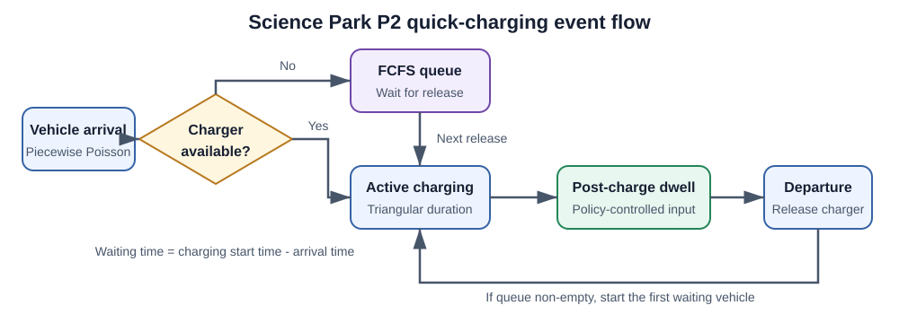
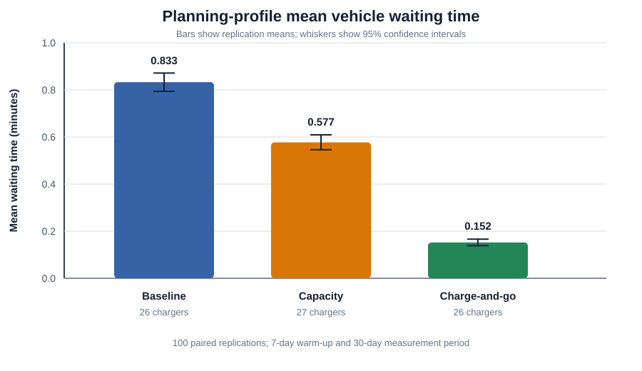
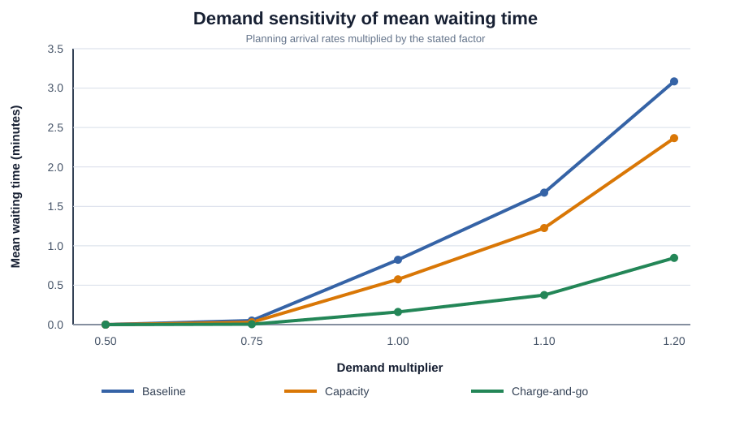

# Reducing Waiting at Science Park P2 EV Quick Chargers: A Discrete-Event Simulation Study

**SEEM3410 System Modeling and Simulation - 2026-27 Term 1**  
**Team members and student IDs:** Ngan Yuk Kuen - 1155212758; Jundong Mei - 1155174217; Zhiyuan Han - 1155176066

## 1. System and Decision Problem

Science Park Car Park P2 provides public electric-vehicle (EV) charging. The September 2026 Environmental Protection Department (EPD) database lists 26 quick chargers and one medium charger at P2. This project studies only the 26 quick chargers because combining charger classes would require power, connector and customer-choice data that are not publicly available.

The simulated customer is an EV requiring quick charging. A vehicle arrives at the quick-charging subsystem, starts immediately if a charger is free, or joins one pooled first-come, first-served (FCFS) queue. A charger remains occupied during active charging and any post-charging dwell before the driver leaves. The system boundary ends when the vehicle departs and releases the space. General parking allocation, charger compatibility, abandonment, reservations, failures, grid constraints and prices are excluded.

The decision question is:

> Under stochastic vehicle arrivals, which policy reduces mean vehicle waiting time more effectively: adding one quick charger or reducing post-charging occupation through a charge-and-go policy?

The primary performance measure is mean vehicle waiting time, including zero waits:

\[
\bar W=\frac{1}{n}\sum_{i=1}^{n}(t^{start}_i-t^{arrival}_i).
\]

Utilisation and queue length are diagnostic measures rather than decision criteria. Figure 1 summarizes the customer flow and state-changing events.

## 2. Data and Input Analysis

The evidence was classified as site-specific observations, external empirical references or synthetic assumptions. This distinction is essential because P2 transaction records are not publicly available. The HKSTP parking page confirms charging availability but does not report charger counts, arrivals, session durations or utilisation. The EPD database supplies the site-specific capacity of 26 quick chargers. A Hong Kong charging-transaction study supports three load-peak windows - 07:00-09:00, 12:00-14:00 and 19:00-21:00 - but is not treated as P2 demand data. A 2026 government reply reports territory-wide fast/quick charger utilisation of approximately 10%-20%; the lower-demand benchmark was calibrated to 16.67% time-weighted utilisation.

| Input | Model and parameters | Units | Evidence status |
|---|---|---:|---|
| Quick chargers | Baseline 26; capacity policy 27 | chargers | 26 is official P2 data; 27 is a decision |
| Vehicle arrivals | Piecewise Poisson; planning rates 1.2-22.8 | vehicles/hour | Synthetic rates; Hong Kong-informed peak timing |
| Active charging | Triangular(20, 45, 90), mean 51.67 | minutes | Synthetic; anchored to Hong Kong technical guidance |
| Baseline dwell | Triangular(0, 10, 30), mean 13.33 | minutes | Synthetic |
| Charge-and-go dwell | Triangular(0, 2, 5), mean 2.33 | minutes | Synthetic policy assumption |

The planning profile targets high peak loads to make policy differences observable and has 192 expected arrivals/day. The current benchmark multiplies all rates by 0.5, giving 96 expected arrivals/day. Within every time block, exponentially distributed interarrival times implement the Poisson process. Triangular distributions were selected for charging and dwell because only plausible bounds and most-likely values, rather than raw observations, were available. All assumptions were fixed before policy results were examined.

## 3. Discrete-Event Simulation Model and Implementation

The model is a terminating daily-cycle simulation implemented with the Python standard library. Its state consists of the simulation clock, a priority-ordered future-event calendar, the number of busy chargers and an FCFS vehicle queue. Three event types change the state:

1. **Arrival:** start charging if a charger is free; otherwise join the queue.
2. **Charging completion:** active charging ends, but the charger stays occupied for the sampled dwell time.
3. **Departure:** the charger is released and the first queued vehicle, if any, starts charging.

At equal timestamps, departures are processed before arrivals so a charger released at that instant does not create an artificial wait. Arrivals stop at the measurement boundary, but the event calendar is drained; therefore every vehicle admitted during measurement eventually starts service and contributes a waiting-time observation.

The initial state is empty. Each replication simulates seven warm-up days followed by 30 measured days. Warm-up vehicles affect the state but are excluded from statistics. Automated verification includes vehicle conservation, deterministic hand calculations, FCFS order, simultaneous events, zero demand and fixed-seed reproducibility. In a one-charger test with ten-minute service and arrivals at minutes 0, 2 and 4, the program returned the hand-calculated waits of 0, 8 and 16 minutes. All 15 automated tests passed. Statistical checks also reproduced the theoretical arrival, charging, dwell and benchmark-utilisation means.

The policies share one simulation engine. Capacity changes only the server count from 26 to 27. Charge-and-go changes only the dwell distribution. Corresponding vehicles use identical arrival times, active-charging quantiles and dwell quantiles across scenarios.

## 4. Experiment Design

The formal experiment evaluates three scenarios: the 26-charger baseline, 27-charger capacity policy and 26-charger charge-and-go policy. Both the high-demand planning profile and the lower current benchmark are studied.

For each profile, 100 independent replications use a seven-day warm-up and 30-day measurement period. Vehicle-level common random numbers preserve matched inputs across policies. Scenario means use two-sided 95% Student-t confidence intervals. Policy effects use paired differences within each seed, defined as baseline waiting minus policy waiting. The planning-profile interval half-widths were below 5% of their corresponding means, so no additional replications were required.

Sensitivity analysis uses 50 paired replications per setting and varies one factor at a time: demand multiplier (0.50-1.20), active-charging scale (0.80-1.20), baseline-dwell scale (0.50-2.00) and charge-and-go dwell scale (1.00-3.00).

## 5. Results and Discussion

### 5.1 Main policy comparison

| Scenario | Mean waiting (minutes) | 95% CI | Mean utilisation |
|---|---:|---:|---:|
| Baseline | 0.8329 | [0.7942, 0.8716] | 33.35% |
| Capacity | 0.5774 | [0.5460, 0.6088] | 32.12% |
| Charge-and-go | 0.1523 | [0.1385, 0.1660] | 27.71% |

Adding one charger reduced mean waiting by 0.2555 minutes (95% paired CI [0.2474, 0.2636]), or 30.68% relative to baseline. Charge-and-go reduced it by 0.6807 minutes (95% paired CI [0.6539, 0.7074]), or 81.72%. Both intervals exclude zero. Charge-and-go performs better because it reduces occupation on every session, whereas capacity adds only one server.

Under the current benchmark, baseline waiting was 0.000319 minute, approximately 0.019 second. The paired improvement intervals for both policies contained zero. Consequently, neither policy has a meaningful waiting-time justification at that demand level. Percentage improvements are not reported because dividing by an almost-zero baseline would be misleading.

### 5.2 Operational trade-offs

Capacity expansion is operationally simple after installation but requires a charging unit, a parking space, electrical capacity and capital expenditure. Charge-and-go uses existing infrastructure but requires reliable completion notifications, signage or enforcement and driver compliance. Because cost data were unavailable, this study cannot calculate a benefit-cost ratio. The recommendation is therefore based only on waiting-time effectiveness and should be reconsidered if implementation costs or customer acceptance are unfavorable.

## 6. Sensitivity Analysis

Figure 3 shows that waiting increases nonlinearly with demand. At 0.5 times planning demand, all waits are effectively zero and the policies are a practical tie. At 1.2 times demand, baseline waiting rises to 3.0854 minutes, compared with 2.3657 for capacity and 0.8467 for charge-and-go.

Across 12 unique one-factor settings, charge-and-go had lower mean waiting than capacity in 11; the remaining low-demand setting was a practical tie. Capacity was not preferred in any tested setting. The closest substantive comparison occurred when baseline dwell was halved: charge-and-go still improved on capacity, but by only 0.0579 minute (about 3.5 seconds). When the charge-and-go dwell mean was tripled from 2.33 to about 7.00 minutes, it still produced 0.3498-minute waiting versus 0.5745 for capacity.

The ranking is robust within the tested ranges, but the magnitude is especially sensitive to baseline dwell. One-factor analysis does not test all interactions. The most valuable future data would be P2 timestamps for arrival, charging completion and departure, which would permit empirical fitting and reveal whether post-charge occupation is large enough to justify enforcement.

## 7. Recommendation and Policy Brief

**Policy brief (197 words).** Science Park P2 should retain its current 26 quick chargers under demand consistent with the published Hong Kong-wide utilisation benchmark, because simulated baseline waiting is already practically zero and neither improvement produces a statistically or operationally meaningful benefit. If P2 instead experiences the high-demand planning conditions represented in this study, it should pilot a charge-and-go policy before installing an additional charger. Under those assumptions, charge-and-go reduces mean waiting from 0.833 to 0.152 minutes, an estimated 81.7% reduction, compared with 30.7% from adding one charger. The mechanism is efficient turnover: reducing post-charge occupation releases capacity after every session, while the capacity policy adds only one server. A pilot could combine automatic completion notifications, clear signage, a short grace period and an overstay rule. Its resource requirement is primarily operating and enforcement effort, whereas capacity expansion requires equipment, space, power and capital. This recommendation applies only when post-charge dwell and peak demand are materially present. P2-specific transaction data are currently unavailable, and both arrival rates and dwell distributions are synthetic. The operator should first collect anonymised arrival, charging-completion and departure timestamps, then update the simulation and confirm the benefit before permanent enforcement or infrastructure spending.

## References

1. Environmental Protection Department. *Locations of EV Chargers for Public Access*, September 2026. <https://www.epd.gov.hk/epd/tc_chi/environmentinhk/air/promotion_ev/locations_ev_chargers.html>
2. Hong Kong Science and Technology Parks Corporation. *Parking*. <https://www.hkstp.org/zh-hk/visit/parking>
3. Electrical and Mechanical Services Department. *Technical Guidelines on Charging Facilities for Electric Vehicles*. <https://www.emsd.gov.hk/filemanager/en/content_2/EV_guidelines.pdf>
4. Hong Kong SAR Government. *LCQ16: Improving charging efficiency of public charging facilities*, 28 October 2026. <https://www.info.gov.hk/gia/general/202610/28/P2026102800314p.htm>
5. Hong Kong University of Science and Technology. *Short-term Load Forecasting of Electric Vehicle Charging Stations in Hong Kong*, using 2022 public-charging transactions. <https://repository.hkust.edu.hk/ir/bitstream/1783.1-152584/1/1783.1-152584.pdf>
